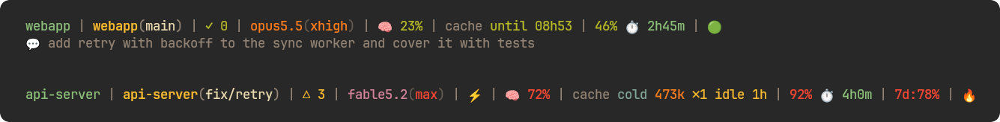

# lps-statusline

[](LICENSE)
[](#requirements)

A two-line status line for [Claude Code](https://github.com/anthropics/claude-code): model and reasoning effort, usage quota with reset countdown, burn-rate pace, git status, context window, and prompt-cache state — at a glance, in Gruvbox.



> **Disclosure:** this project was written almost entirely by Claude Code itself — code, tests, and docs — with a human steering, vetoing, and using it daily. A statusline for Claude, by Claude.

It's one bash script. No Python, no network calls, no credentials — it just renders the JSON that Claude Code already pipes to statusline commands.

## Install

```bash
curl -sSL https://raw.githubusercontent.com/pedrotspinola/lps-statusline/main/install-remote.sh | bash
```

Or clone and run `./install.sh`. Restart Claude Code afterwards.
Uninstall anytime with `~/.local/share/lps-statusline/uninstall.sh`.

## What it shows

- **directory** — aqua when it's a Claude project (`CLAUDE.md`/`.claude/` present)
- **git** — `repo(branch)` plus changed-file count (✓ clean, △ few, ● many)
- **model + effort** — `fable5(xhigh)`: family-colored model, effort color-coded low→max
- 🧠 — context window used, green→red
- **cache** — `cache until 19h42`: the prompt cache stays warm until that time. `cache cold 90k`: it expired, so your next message writes ~90k tokens to the cache again. After a cache miss, `✗2 tools` adds the session's miss count and the likely cause of the last one (`idle 1h`, `tools`, `model`, `system prompt`, …). It's a clock time rather than a countdown because, while you're idle, Claude Code re-runs the status line only when the cache expires or a quota window resets (or every `statusLine.refreshInterval` seconds, if set) — a countdown would show a stale value
- **quota** — 5-hour usage % and ⏱️ time until reset
- **pace** — 💤 🔵 🟢 🟡 🟠 🔴 🔥 — how fast you're burning the 5-hour window
- 💬 — your last message, on the second line (best-effort)

And only when it matters: **7d:N%** (weekly quota past 65%), **⚡** (fast mode), **🚨🚨🚨** (a quota window exhausted — opt-in via `LPS_STATUSLINE_EXTRA_USAGE=1`).

## Customize

Colors, separators, and every threshold live at the top of `statusline.sh` — edit them and the next render picks it up, no restart. The cache time defaults to `19h42`; `export LPS_STATUSLINE_TIME_FORMAT='%H:%M'` gives `19:42` (any strftime format). The installer can also add a small Claude Code **skill** so Claude itself can make those edits for you, from any directory.

## Requirements

- bash 4+, `jq`, `git` — Linux, macOS (Homebrew bash), or WSL, on any true-color terminal
- Claude Code ≥ 2.1.214 for the quota and effort sections, ≥ 2.1.251 for the cache section (≥ 2.1.260 for miss causes) — each hides gracefully on older versions
- quota is meaningful on Claude Pro/Max plans — API-key sessions have no rate limits to show

## Credits

Context-window logic inspired by [ccstatusline](https://github.com/sirmalloc/ccstatusline); the last-message line is adapted from [claude-code-tips](https://github.com/ykdojo/claude-code-tips). Earlier versions fetched quota from claude.ai with browser cookies — Claude Code now provides it natively, so all of that machinery is gone (it lives in git history).

MIT licensed. Independent community project — not affiliated with Anthropic; "Claude" and "Claude Code" are Anthropic trademarks.
